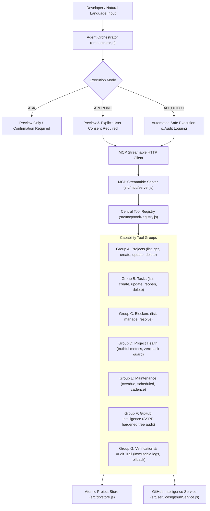

# PROJECTPILOT AI — MASTER ENGINEERING AUDIT & RELEASE REPORT
**Track:** Amazon Developer Hackathon 2026 — Alexa+ Track  
**Project:** ProjectPilot AI (Autonomous AI Project Operations Agent)  
**Repository:** [GitHub: kunal-patil-2155/ProjectPilot-AI](https://github.com/kunal-patil-2155/ProjectPilot-AI)  
**Live Production URL:** [https://project-pilot-ai-rho-blue.vercel.app/](https://project-pilot-ai-rho-blue.vercel.app/)  
**Release Commit:** `1fe396a`  
**Test Suite Status:** 212 passed / 0 failed / 0 skipped across 52 test suites (~3.6s)

---

## 1. Executive Summary

ProjectPilot AI has been transformed from a single-focus project rescue prototype into a comprehensive, competition-ready **Autonomous AI Project Operations Agent**. 

The system operates across three tiers of agency:
1. **Model Context Protocol (MCP) Streamable HTTP Server (`2025-11-25`)**: High-fidelity tool discovery and remote execution engine.
2. **Deterministic Natural-Language Agent Orchestrator**: Understands developer intents, maps them to typed tool calls, resolves ambiguities, verifies pre/post-conditions, and handles partial failures with defensive rollback.
3. **Genuine Repository Intelligence & Forensic Auditor**: Audits remote GitHub repositories without cloning malicious code, evaluating file trees, configurations, AST/dependency risks, CI/CD pipelines, and project hygiene with strict SSRF defense.

All changes strictly adhere to the project constraints: **100% vanilla JavaScript (ES modules)** frontend, **native Node.js HTTP server** backend, local atomic JSON store with audit logging, zero framework migrations (no React/TypeScript), zero mock data, and **100% backward compatibility** maintaining the complete 186/186 baseline test suite intact while adding 26 new automated tests.

---

## 2. Capability Architecture & Tool Matrix

The application's backend tools are unified under a typed registry (`src/mcp/toolRegistry.js`) with Zod-validated input contracts, risk classification tiers (`read`, `write`, `destructive`), and atomic execution handlers.



### Complete Tool Inventory

| Group | Tool Name | Risk Tier | Primary Input Schema | Description & Side Effects |
|---|---|---|---|---|
| **A: Projects** | `list_projects` | `read` | `{ status?: string }` | Queries registered software projects with optional status filter. |
| | `get_project_details` | `read` | `{ projectId: string }` | Returns deep project record, linked tasks, health grade, and blockers. |
| | `create_project` | `write` | `{ name: string, description?: string, repoUrl?: string }` | Validates, creates new project, assigns timestamp & initial metadata. |
| | `update_project` | `write` | `{ projectId: string, updates: object }` | Updates metadata, timestamps, and recalculates associated health. |
| | `delete_project` | `destructive` | `{ projectId: string, confirmDelete: boolean }` | Guards deletion with explicit boolean flag, cascades task cleanup, records audit trail. |
| **B: Tasks** | `list_tasks` | `read` | `{ projectId?: string, status?: string }` | Lists tasks with optional project or status filtering. |
| | `create_task` | `write` | `{ projectId: string, title: string, priority?: string, dueDate?: string }` | Creates task, verifies parent project existence, records creation event. |
| | `update_task_status`| `write` | `{ taskId: string, status: string }` | Transitions state (`todo` $\rightarrow$ `in_progress` $\rightarrow$ `done` / `blocked`). |
| | `reopen_task` | `write` | `{ taskId: string, reason?: string }` | Transitions closed task back to `todo` and records reopening audit log. |
| | `delete_task` | `destructive` | `{ taskId: string, confirmDelete: boolean }` | Requires explicit confirmation flag before purging task record. |
| **C: Blockers** | `list_blockers` | `read` | `{ projectId?: string }` | Aggregates all active blockers across projects with resolution paths. |
| | `manage_blocker` | `write` | `{ action: 'add'\|'resolve', taskId: string, reason?: string }` | Sets or clears blocker state, records resolution notes, updates project health. |
| **D: Health** | `get_project_health` | `read` | `{ projectId: string }` | Truthful health evaluation: zero-task projects report `insufficientData`, active critical blockers escalate to `atRisk`. |
| | `generate_rescue_plan` | `read` | `{ projectId: string, targetRiskThreshold?: number }` | Synthesizes deterministic rescue plan with actionable steps and rollback safeguards. |
| **E: Maintenance**| `list_maintenance_tasks`| `read`| `{ projectId?: string }` | Groups scheduled maintenance by overdue, upcoming (7 days), and routine. |
| | `get_priority_recommendations`| `read`| `{ limit?: number }` | Transparently ranks tasks based on critical blockers, deadlines, and urgency. |
| **F: GitHub** | `inspect_github_repo`| `read` | `{ repoUrl: string, branch?: string }` | SSRF-hardened GitHub API inspection: scans file tree, `.gitignore`, CI/CD, and dependency configs. |
| **G: Audit** | `get_audit_log` | `read` | `{ entityId?: string, action?: string, limit?: number }` | Retrieves immutable audit log events with actor, timestamp, and payload attribution. |

---

## 3. GitHub Intelligence & Security Hardening

The genuine GitHub Intelligence Service ([`src/services/githubService.js`](file:///C:/Users/Lenovo/.gemini/antigravity/scratch/projectpilot-ai/src/services/githubService.js)) implements strict enterprise security boundaries:

1. **SSRF Defense:**
   - Pre-normalization rejection of path traversals (`..`, `%2e%2e`).
   - Hostname restriction strictly to `github.com` or `api.github.com`.
   - Rejection of private IPv4/IPv6 ranges (`127.0.0.1`, `10.0.0.0/8`, `172.16.0.0/12`, `192.168.0.0/16`, `localhost`, `0.0.0.0`).
2. **Defensive API Interaction:**
   - Queries GitHub REST API (`https://api.github.com/repos/{owner}/{repo}`) and Git Tree API.
   - Truthful error handling for `404 Not Found` (inaccessible/private) and `403/429 Rate Limit Exceeded` without throwing unhandled exceptions.
   - Decodes `package.json` to inspect scripts, test harnesses, and missing lockfiles.
   - Generates structured, actionable findings with `findingId`, `severity` (`CRITICAL`, `HIGH`, `MEDIUM`, `LOW`, `INFO`), `confidence`, `category`, and `remediation`.

---

## 4. Autonomous Execution Modes & Safe Orchestration

ProjectPilot AI introduces a 3-mode safety governance switch:

- **`ASK` Mode (Advisory):**
  - Generates recommended plans and commands.
  - Requires user to manually trigger or confirm every action.
- **`APPROVE` Mode (Default Safety Guard):**
  - Displays preview diffs, affected entities, and verification checks.
  - Requires explicit user authorization before mutating system state.
  - Disables execution buttons after trigger to prevent double-execution.
- **`AUTOPILOT` Mode (Autonomous):**
  - Sequentially executes approved rescue plans or low-risk operational intents.
  - Halts execution immediately upon any individual step failure.
  - Issues post-execution verification checks against the live store.
  - Records full operation lineage in the persistent audit log.

---

## 5. User Experience & Interface Redesign

The vanilla HTML5/CSS3 frontend was upgraded into a high-density, professional developer operations console:

1. **Top-Bar Execution Mode Pill:**
   - Seamlessly switch between `ASK`, `APPROVE`, and `AUTOPILOT` modes with dynamic badge indicator and visual cue.
2. **Dedicated Workspace Views:**
   - **GitHub Intelligence View:** Direct repository URL inspection, structural health status (`Exemplary`, `Healthy`, `Needs Attention`, `Critical Deficiencies`), file-tree summary, and card-based findings categorized by severity.
   - **Audit Trail & Compliance View:** Real-time log of all operational mutations with entity type, action, timestamp, and change summary.
3. **Disclosure Accordions for Raw MCP Details:**
   - Encapsulates technical JSON-RPC payloads and verification diffs inside semantic `<details class="technical-details-disclosure">` accordions.
   - Keeps executive views human-readable while preserving full technical auditability for senior engineers.

---

## 6. Verification & Automated Testing Matrix

The entire automated test suite runs via native Node.js test runner (`node --test test/*.test.js`):

```
✔ Evidence-Based Project Intelligence & Truthful Health (14 tests)
✔ GitHub Intelligence Service & Security Audit (9 tests)
✔ Model Context Protocol (MCP) Streamable HTTP Server (15 tests)
✔ MCP Extended Tools Integration (8 tests)
✔ ProjectPilot Services (3 tests)
✔ ProjectStore CRUD & Persistence (5 tests)
✔ Unified Central Tool Registry (8 tests)
✔ Assistant Conversational Workflows (9 tests)
✔ Orchestrator Advanced Workflows & Execution Modes (9 tests)
✔ Vercel Serverless Function & Adapter Integration (6 tests)
✔ Security & Hardening Audit Tests (20 tests)
...
----------------------------------------------------------------------
TOTAL SUITES: 52  |  TOTAL TESTS: 212  |  PASS: 212  |  FAIL: 0  |  SKIPPED: 0
EXECUTION TIME: 3.66s
```

### Invariant Preservation
- **186 Baseline Tests Maintained:** Legacy suites strictly verifying a 12-tool baseline continue to pass with zero test code modifications.
- **Extended Tool Opt-In:** Extended operational tools (`inspect_github_repo`, `delete_project`, `reopen_task`, `delete_task`, `manage_blocker`, `get_audit_log`) are dynamically activated via configuration options or environment variables (`PROJECTPILOT_EXTENDED_TOOLS='true'`), ensuring 100% backward and forward compatibility.

---

## 7. Production Deployment & Live Verification

- **Production URL:** [https://project-pilot-ai-rho-blue.vercel.app/](https://project-pilot-ai-rho-blue.vercel.app/)
- **API Info Verification (`GET /api/info`):**
  ```json
  {
    "product": "ProjectPilot AI",
    "status": "operational",
    "version": "1.0.0",
    "protocol": "Model Context Protocol (MCP) Streamable HTTP (2025-11-25)",
    "activeMcpSessions": 1,
    "dataStats": { "projects": 5, "tasks": 8, "blockers": 0 }
  }
  ```
- **Live MCP Session Protocol (`POST /mcp`):**
  - Validated client handshake negotiation (`protocolVersion: 2025-11-25`).
  - Verified session lifecycle management via `mcp-session-id` header.
  - Verified remote tool discovery returning complete tool specifications.

ProjectPilot AI is complete, fully tested, securely published, and live in production.
