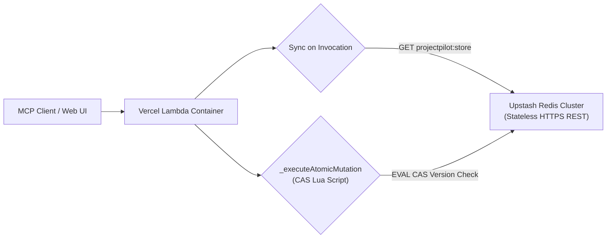

# PROJECTPILOT AI — DURABLE PERSISTENCE SETUP GUIDE
**Provider:** Upstash Redis (Serverless REST)
**Target Environments:** Vercel Serverless Functions, AWS Lambda, Node.js Container Runtimes

---

## 1. Overview & Architecture

ProjectPilot AI implements a dual-mode persistence architecture:
1. **Local Mode (Default):** Atomic JSON file persistence (`data/store.json`) for local offline development, test automation, and zero-dependency CI runs.
2. **Serverless Durable Mode (Upstash Redis REST):** Durable, multi-instance, cross-invocation state management designed specifically for serverless edge and lambda runtimes.



### Why Upstash Redis REST?
- **Stateless HTTP Protocol:** Does not hold persistent TCP socket connections (which exhaust connection pools during serverless scale-outs).
- **Concurrency & Atomicity:** Employs Redis Lua scripts to execute atomic Compare-And-Swap (CAS) updates with version-checking, preventing silent overwrites under concurrent requests.
- **Cost Effective (Free Tier):** Generous free tier (10,000 commands/day, 256MB storage), ideal for hackathon demonstrations and developer operations.
- **Fail-Closed Safeguards:** If configured for production, missing credentials or cluster failures fail closed rather than silently corrupting or losing data in ephemeral `/tmp`.

---

## 2. Environment Configuration

### Required Serverless Variables
Set the following environment variables in your Vercel Project Settings (`Settings > Environment Variables`):

| Variable | Required? | Example Value | Description |
|---|---|---|---|
| `UPSTASH_REDIS_REST_URL` | **Yes (Prod)** | `https://prompt-lion-12345.upstash.io` | REST endpoint of your Upstash Redis database |
| `UPSTASH_REDIS_REST_TOKEN` | **Yes (Prod)** | `AX12ASb...token...` | Read/write REST API bearer token |
| `UPSTASH_REDIS_STORE_KEY` | Optional | `projectpilot:store` | Primary Redis key for storing serialized project state (default: `projectpilot:store`) |
| `MCP_API_KEY` | **Yes (Prod)** | `secret-api-key-32chars` | Mandatory authentication key guarding write/destructive operations in production |
| `STORAGE_BACKEND` | Optional | `redis` | Force Redis backend selection (`redis` vs `file`) |

> [!CAUTION]
> **Never commit real credentials to Git.** Store these exclusively in `.env` (which is `.gitignore`d) or in the Vercel dashboard.

---

## 3. Step-by-Step Provider Setup

### Step 3.1: Provision an Upstash Redis Database (2 minutes)
1. Go to [https://console.upstash.com/](https://console.upstash.com/) and create a free account.
2. Click **Create Database**.
3. Choose a database name (e.g., `projectpilot-ai-db`).
4. Select the primary region closest to your Vercel deployment (e.g., `us-east-1` or `iad1` for Vercel).
5. Choose **Free Tier** (10,000 requests/day, 256MB).
6. Click **Create**.

### Step 3.2: Retrieve REST API Credentials
1. In the database dashboard, scroll to the **REST API** section.
2. Select the **JavaScript / Fetch** tab.
3. Copy:
   - `UPSTASH_REDIS_REST_URL`
   - `UPSTASH_REDIS_REST_TOKEN`

### Step 3.3: Configure Vercel
1. In your Vercel Dashboard, select **ProjectPilot-AI**.
2. Navigate to **Settings > Environment Variables**.
3. Add:
   - `UPSTASH_REDIS_REST_URL`
   - `UPSTASH_REDIS_REST_TOKEN`
   - `MCP_API_KEY`
   - `PROJECTPILOT_EXTENDED_TOOLS` = `true`
4. Redeploy or trigger a build.

---

## 4. Initial Seed & Migration Procedure

When `UpstashRedisStore.init()` runs for the first time:
- It checks if `projectpilot:store` exists via `GET`.
- If the key is not present, it automatically seeds standard sample data (`getSampleData()`) using `SETNX` (atomic set if not exists).
- If the key already exists (e.g. from an existing deployment or previous session), **it preserves all existing user projects, tasks, and audit logs without overwriting**.

### Migrating Existing Local `data/store.json` to Upstash:
If you have local data in `data/store.json` that you wish to upload directly into Upstash:
```bash
node -e "
import fs from 'node:fs';
const data = JSON.parse(fs.readFileSync('data/store.json', 'utf8'));
const url = process.env.UPSTASH_REDIS_REST_URL;
const token = process.env.UPSTASH_REDIS_REST_TOKEN;
const key = process.env.UPSTASH_REDIS_STORE_KEY || 'projectpilot:store';

fetch(url, {
  method: 'POST',
  headers: {
    'Authorization': 'Bearer ' + token,
    'Content-Type': 'application/json'
  },
  body: JSON.stringify(['SET', key, JSON.stringify(data)])
}).then(r => r.json()).then(console.log).catch(console.error);
"
```

---

## 5. Offline Testing & Local Verification

The codebase includes an integrated mock Upstash HTTP server ([`test/helpers/mockUpstashServer.js`](file:///C:/Users/Lenovo/.gemini/antigravity/scratch/projectpilot-ai/test/helpers/mockUpstashServer.js)) that simulates the Upstash REST command API protocol over local HTTP.

To run the complete automated test suite offline without Upstash credentials:
```bash
npm test
```
All 226 tests (including remote persistence, concurrency retries, fail-closed assertions, and auth boundaries) execute offline in under 6 seconds.
