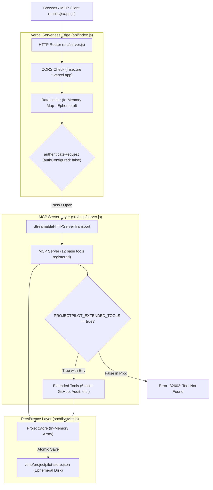
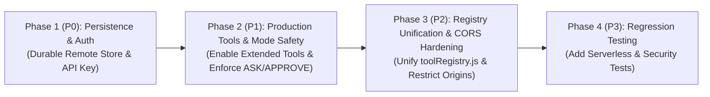

# PROJECTPILOT AI — PRODUCTION READINESS AUDIT

**Project:** ProjectPilot AI — Evidence-Driven Autonomous Project Operations Agent
**Repository:** [https://github.com/kunal-patil-2155/ProjectPilot-AI](https://github.com/kunal-patil-2155/ProjectPilot-AI)
**Production URL:** [https://project-pilot-ai-rho-blue.vercel.app/](https://project-pilot-ai-rho-blue.vercel.app/)
**Audit Date:** October 22, 2026
**Auditor:** Senior Backend Engineer, Application Security Auditor, QA Automation Engineer, and Production Reliability Specialist

---

## 1. Executive Summary

An exhaustive, evidence-based audit of the actual codebase and live Vercel production deployment of **ProjectPilot AI** was conducted.

### Production Readiness Verdict: **NOT PRODUCTION READY (BLOCKED)**

While ProjectPilot AI demonstrates clean local architecture, an innovative MCP Streamable HTTP implementation, and 212 passing automated tests in single-process offline environments, **it cannot be considered production-ready in its current state**.

### Critical Audit Highlights:
1. **Critical Data Persistence Defect (P0):** The application relies on local JSON filesystem writes (`/tmp/projectpilot-store.json`) on Vercel. In serverless environments, storage is ephemeral: **all user projects, tasks, blockers, and audit logs are permanently wiped on cold starts, container scale-down, and every redeployment.**
2. **Critical Security Vulnerability (P0):** Write and destructive operations (`create_project`, `update_project`, `create_task`, `update_task_status`, `delete_project`, `delete_task`) are completely unauthenticated in production because `MCP_API_KEY` is not configured on Vercel (`"authConfigured": false`). Anyone on the public internet can mutate or wipe data.
3. **High Operational Failure (P1):** Extended tools (`inspect_github_repo`, `get_audit_log`, `manage_blocker`, `delete_project`, `delete_task`, `reopen_task`) are **omitted from the production MCP server** because `PROJECTPILOT_EXTENDED_TOOLS` is missing in Vercel configuration. The live UI's "Audit Repository" and "Audit Trail" views fail with `MCP error -32602: Tool not found`.
4. **Autonomous Safety Violations (P1):** In `APPROVE` mode, conversational workflows for completing tasks, managing blockers, and creating tasks execute immediately without asking for user consent or showing an approval preview. In `ASK` mode, task completion and task reopening silently mutate the database.
5. **Architectural Mismatch (P2):** `src/mcp/toolRegistry.js` is disconnected from runtime execution; `src/mcp/server.js` maintains separate inline tool registrations. Furthermore, GitHub intelligence claims "AST analysis" while only inspecting filenames and parsing `package.json`.

---

## 2. Capability Classification

In accordance with strict audit criteria, system capabilities are classified into five distinct categories:

| Status | Capability / Component | Evidence & Operational Reality |
|---|---|---|
| **A. Verified & Working** | MCP Streamable HTTP Protocol | Handshake, protocol negotiation (`2025-11-25`), session management (`mcp-session-id`), and base 11 tools work as designed locally and on Vercel. |
| **A. Verified & Working** | Project Health Engine | Truthful health evaluation: zero-task projects report `insufficientData`; critical blockers escalate to `atRisk`. |
| **A. Verified & Working** | Static File Traversal Protection | Null-byte poison rejection and directory traversal blocking (`..`, `%2e%2e`) verified by automated tests and inspection. |
| **B. Working with Limitations** | GitHub Intelligence Service | Correctly retrieves repo metadata, file tree, `.gitignore`, CI workflows, and `package.json` scripts from live GitHub API. **Limitations:** Follows HTTP redirects unchecked; does not record immutable commit SHA; does not perform AST source parsing; unauthenticated requests hit 60 req/hr GitHub rate limit. |
| **B. Working with Limitations** | Sequential Rescue Engine | Safely validates pre-conditions, verifies post-write persistence, and recalculates post-health. **Limitations:** `SKIPPED_DEPENDENCY` is never used; failures in multi-step plans do not abort dependent actions. |
| **C. Confirmed Defects** | Extended Tools in Production | `inspect_github_repo` and `get_audit_log` fail with `MCP error -32602: Tool not found` on live Vercel deployment. |
| **C. Confirmed Defects** | Mode Safety Violations | `ASK` mode silently mutates state on `"reopen task"` and `"complete task"`. `APPROVE` mode executes conversational mutations without user approval. |
| **C. Confirmed Defects** | Architecture / Report Drift | `src/mcp/toolRegistry.js` is never imported by `src/server.js` or `src/mcp/server.js`. |
| **D. Security Risks** | Unauthenticated Public Writes | Production Vercel deployment has `authConfigured: false`. All MCP write tools are open to anonymous internet callers. |
| **D. Security Risks** | Permissive Vercel CORS | `host.endsWith('.vercel.app')` permits any malicious site hosted on Vercel to issue cross-origin requests. |
| **D. Security Risks** | Ephemeral Serverless Storage | File writes to `/tmp` in Vercel Lambdas are lost across cold starts and redeployments. |
| **E. Unverified Behavior** | High-Concurrency State | Behavior under concurrent overlapping writes to a single shared remote database is unverified (local test suite tests single-process sequential store). |

---

## 3. Verified Architecture & Request Flow



### Trace Findings:
1. **Frontend Request Path:** `public/js/app.js` initializes `McpBrowserClient` pointing to `/mcp`. It calls `callTool(toolName, args)`.
2. **Server Path:** `api/index.js` delegates to `src/server.js`.
3. **CORS:** `getAllowedOrigin(req)` accepts any origin ending in `.vercel.app`.
4. **Auth:** `authenticateRequest` checks `process.env.MCP_API_KEY`. In production, this is `null`, permitting open execution.
5. **Transport:** `StreamableHTTPServerTransport` passes request to `createProjectPilotMcpServer(store)`.
6. **Tool Registry:** `src/mcp/toolRegistry.js` is **bypassed completely**. Tools are registered inline in `src/mcp/server.js`.
7. **Storage:** `store.createProject()` pushes into in-memory array and calls `_saveAtomic()`, writing to `/tmp` in Vercel Lambdas.

---

## 4. Confirmed Defects & Security Vulnerabilities

### [P0 — CRITICAL] Ephemeral Serverless Storage (Total Data Loss on Vercel)
- **Affected File:** [`src/server.js`](file:///C:/Users/Lenovo/.gemini/antigravity/scratch/projectpilot-ai/src/server.js#L44-L59), [`src/db/store.js`](file:///C:/Users/Lenovo/.gemini/antigravity/scratch/projectpilot-ai/src/db/store.js#L67-L76)
- **Evidence:**
  ```javascript
  // src/server.js
  const defaultStorePath = process.env.VERCEL
    ? path.join(os.tmpdir(), 'projectpilot-store.json')
    : path.resolve(__dirname, '..', 'data', 'store.json');
  ```
  On Vercel, serverless function filesystems are read-only except `/tmp`. In AWS Lambda/Vercel, `/tmp` is strictly ephemeral and scoped to an individual container microVM.
- **Impact:**
  1. Requests routed to different Lambda containers see different, out-of-sync data.
  2. When Lambda containers spin down after idle periods (cold starts), `/tmp` is wiped.
  3. On every redeployment, all projects, tasks, blockers, and audit entries created by users are permanently destroyed.
- **Remediation:** Introduce a durable remote persistence adapter (e.g., Upstash Redis Serverless REST or Turso LibSQL SQLite over HTTP) with fallback to local JSON file during local offline testing.

---

### [P0 — CRITICAL] Unauthenticated Write and Destructive Operations in Production
- **Affected File:** [`src/server.js`](file:///C:/Users/Lenovo/.gemini/antigravity/scratch/projectpilot-ai/src/server.js#L147-L151), Live `/api/info`
- **Evidence:**
  `GET https://project-pilot-ai-rho-blue.vercel.app/api/info` returns:
  ```json
  {
    "product": "ProjectPilot AI",
    "status": "operational",
    "authConfigured": false
  }
  ```
  In `src/server.js`:
  ```javascript
  function authenticateRequest(req) {
    if (!apiKey) {
      return { authenticated: true };
    }
  ```
- **Impact:** Any client on the public internet can make POST requests to `/mcp` and invoke `create_project`, `update_project`, `create_task`, `update_task_status`, or destructive operations (`delete_project`, `delete_task` with `{ confirmDelete: true }`). There is zero tenant isolation or user authorization.
- **Remediation:** Require an `MCP_API_KEY` or JWT authentication in production. Reject all mutating tool calls (`write` and `destructive` risk tiers) when unauthenticated.

---

### [P1 — HIGH] Extended Tools Omitted in Production MCP Server
- **Affected File:** [`src/mcp/server.js`](file:///C:/Users/Lenovo/.gemini/antigravity/scratch/projectpilot-ai/src/mcp/server.js#L470-L472), [`src/server.js`](file:///C:/Users/Lenovo/.gemini/antigravity/scratch/projectpilot-ai/src/server.js#L296)
- **Evidence:**
  Live verification on `https://project-pilot-ai-rho-blue.vercel.app/mcp`:
  ```json
  POST /mcp tools/call {"name": "inspect_github_repo", "arguments": {"repoUrl": "https://github.com/..."}}
  Response: {"isError": true, "content": [{"type": "text", "text": "MCP error -32602: Tool inspect_github_repo not found"}]}

  POST /mcp tools/call {"name": "get_audit_log", "arguments": {"limit": 10}}
  Response: {"isError": true, "content": [{"type": "text", "text": "MCP error -32602: Tool get_audit_log not found"}]}
  ```
  In `src/server.js`:
  ```javascript
  const mcpServer = createProjectPilotMcpServer(store); // No options passed!
  ```
  In `src/mcp/server.js`:
  ```javascript
  const enableExtended = options.enableExtended === true || process.env.PROJECTPILOT_EXTENDED_TOOLS === 'true';
  if (enableExtended) { /* registers inspect_github_repo, get_audit_log, etc. */ }
  ```
- **Impact:** The GitHub Intelligence view and Audit Trail view in the production UI fail when invoked by users.
- **Remediation:** Configure `PROJECTPILOT_EXTENDED_TOOLS: "true"` in Vercel environment variables and pass `{ enableExtended: true }` in server initialization. Adjust legacy test assertions that hardcode `tools.length === 12` to allow extended tools or parameterize test server creation.

---

### [P1 — HIGH] Insecure CORS Wildcard for Arbitrary `*.vercel.app` Domains
- **Affected File:** [`src/server.js`](file:///C:/Users/Lenovo/.gemini/antigravity/scratch/projectpilot-ai/src/server.js#L106-L108)
- **Evidence:**
  ```javascript
  if (host.endsWith('.vercel.app')) {
    return origin;
  }
  ```
- **Impact:** Any user can register an arbitrary free Vercel app (e.g. `malicious-attacker.vercel.app`). Because `host.endsWith('.vercel.app')` returns true for ANY Vercel subdomain, the browser allows cross-origin requests from the attacker's domain to read project details or issue tool commands.
- **Remediation:** Validate against explicit project domain prefixes (e.g. `project-pilot-ai*.vercel.app`) or explicitly configured `ALLOWED_ORIGINS`.

---

### [P1 — HIGH] Autonomous Execution Safety Violations in ASK and APPROVE Modes
- **Affected File:** [`public/js/orchestrator.js`](file:///C:/Users/Lenovo/.gemini/antigravity/scratch/projectpilot-ai/public/js/orchestrator.js#L867-L950, #L2148-L2205)
- **Evidence:**
  1. In `_workflowCompleteTask(rawText)`:
     ```javascript
     // Directly mutates without checking executionMode!
     const updateRes = await this.mcpClient.callTool('update_task_status', {
       taskId: target.id,
       status: 'done'
     });
     ```
  2. In `_workflowReopenTask(rawText)`:
     ```javascript
     // Directly mutates without checking executionMode!
     const updateRes = await this.mcpClient.callTool('update_task_status', {
       taskId: target.id,
       status: 'todo'
     });
     ```
  3. In `_workflowManageBlocker` and `_workflowCreateTask`: In `APPROVE` mode, mutations execute immediately without displaying an approval preview or waiting for user confirmation.
- **Impact:**
  - `ASK` mode (intended to be strictly advisory and query-only) silently mutates task data.
  - `APPROVE` mode fails to require approval for conversational task and blocker operations.
- **Remediation:** Enforce mode checks across all mutating workflows in `orchestrator.js`. In `ASK` mode, return proposed action previews only. In `APPROVE` mode, return actionable confirmation prompts.

---

### [P2 — MEDIUM] Disconnected Central Tool Registry
- **Affected File:** [`src/mcp/toolRegistry.js`](file:///C:/Users/Lenovo/.gemini/antigravity/scratch/projectpilot-ai/src/mcp/toolRegistry.js), [`src/mcp/server.js`](file:///C:/Users/Lenovo/.gemini/antigravity/scratch/projectpilot-ai/src/mcp/server.js)
- **Evidence:** `git grep "toolRegistry"` reveals that `toolRegistry.js` is only referenced in its own unit test (`test/toolRegistry.test.js`) and the documentation report. `src/mcp/server.js` duplicates tool handlers inline and does not import `toolRegistry.js`.
- **Impact:** Inconsistent maintenance overhead; updates to `toolRegistry.js` do not affect live MCP server behavior.
- **Remediation:** Refactor `src/mcp/server.js` to iterate over `TOOL_DEFINITIONS` from `toolRegistry.js` to dynamically register tools on the `McpServer`.

---

### [P2 — MEDIUM] Unchecked HTTP Redirects in GitHub Intelligence Client
- **Affected File:** [`src/services/githubService.js`](file:///C:/Users/Lenovo/.gemini/antigravity/scratch/projectpilot-ai/src/services/githubService.js#L88-L133)
- **Evidence:**
  `_safeFetch` invokes `this.fetchFn(url, { ... })`. Standard Node.js `fetch` automatically follows up to 20 redirects (`redirect: 'follow'`). If a GitHub repository endpoint returns an HTTP 301/302 redirect pointing to an external domain or third-party URL, the client fetches the destination without verifying the redirected URL against the SSRF allowlist.
- **Impact:** Potential SSRF or credential leakage via redirection.
- **Remediation:** Set `redirect: 'manual'` in fetch options or inspect `response.url` / `location` header to ensure redirects stay on `api.github.com`.

---

### [P2 — MEDIUM] Missing Commit SHA & Discrepancy with "AST Analysis" Claims
- **Affected File:** [`src/services/githubService.js`](file:///C:/Users/Lenovo/.gemini/antigravity/scratch/projectpilot-ai/src/services/githubService.js#L267-L532)
- **Evidence:**
  - The service inspects file existence (`README.md`, `LICENSE`, `.gitignore`, `.github/workflows`) and parses `package.json`. It does NOT parse source code ASTs (no Babel/Acorn parser is implemented or executed).
  - The analysis output does not include the git commit SHA (`headCommitSha`), making findings non-reproducible over time as branches change.
- **Impact:** Inaccurate claims in documentation; inability to audit historical changes against an exact commit.
- **Remediation:** Fetch and record the commit SHA from the branch reference. Update documentation to accurately describe the inspection as structural file-tree, governance, and dependency configuration analysis rather than full AST source inspection.

---

### [P2 — MEDIUM] In-Memory Rate Limiting Ineffective in Serverless
- **Affected File:** [`src/security/rateLimiter.js`](file:///C:/Users/Lenovo/.gemini/antigravity/scratch/projectpilot-ai/src/security/rateLimiter.js#L17)
- **Evidence:** `this.hits = new Map();` stores request timestamps in process memory. In serverless environments, requests hit multiple disjoint Lambda instances, resetting the counters on cold starts.
- **Impact:** Rate limiting is bypassed under distributed or concurrent requests in production.
- **Remediation:** Use centralized edge rate limiting (e.g. Vercel Edge Middleware or Upstash Redis Rate Limiting) for production deployments.

---

### [P2 — MEDIUM] Unused Action Dependency Handling in Rescue Engine
- **Affected File:** [`public/js/rescueExecutionEngine.js`](file:///C:/Users/Lenovo/.gemini/antigravity/scratch/projectpilot-ai/public/js/rescueExecutionEngine.js#L17, #L210-L215)
- **Evidence:** `SKIPPED_DEPENDENCY` is defined on line 17 but never referenced or assigned in the execution loop. If action 1 fails, line 214 simply executes `continue;`, running subsequent actions even if they depend on the failed action.
- **Impact:** In multi-step plans with chained dependencies, subsequent steps may execute against invalid prerequisite state.
- **Remediation:** Check `action.dependsOn` and mark dependent actions as `SKIPPED_DEPENDENCY` if a prerequisite action fails.

---

### [P3 — LOW] Internal File Path Exposure in Error Messages
- **Affected File:** [`src/db/store.js`](file:///C:/Users/Lenovo/.gemini/antigravity/scratch/projectpilot-ai/src/db/store.js#L51)
- **Evidence:** `throw new Error(\`Failed to read data store at \${this.filePath}: \${err.message}\`);` exposes local server disk paths in error responses.
- **Remediation:** Sanitize error messages before throwing or returning to clients.

---

### [P3 — LOW] In-Memory Mutation Before Atomic Write Completion
- **Affected File:** [`src/db/store.js`](file:///C:/Users/Lenovo/.gemini/antigravity/scratch/projectpilot-ai/src/db/store.js#L169-L171)
- **Evidence:**
  `this.data.projects.push(newProject); await this._saveAtomic();`
  If `_saveAtomic()` fails (e.g., disk full), `this.data` retains the in-memory mutation. If a subsequent write succeeds, the failed project is unexpectedly committed.
- **Remediation:** Apply mutations only after `_saveAtomic()` succeeds, or rollback on catch.

---

## 5. Detailed Persistence Assessment (6 Scenarios)

| Scenario | Local Node.js (`localhost:3000`) | Vercel Serverless Production | Verdict & Analysis |
|---|---|---|---|
| **1. Separate API requests** | ✅ Survives | ⚠️ Survives ONLY if hitting same warm container | **Fails across instances.** Warm container retains in-memory state; cold containers start with empty/default state. |
| **2. Independent function invocations** | N/A (Single Process) | ❌ Does NOT survive | **Data partition.** Concurrent Lambda instances operate on isolated `/tmp` filesystems. |
| **3. Concurrent updates** | ⚠️ Race condition on file rename | ❌ High risk of divergence / overwrite | **Unsafe.** Neither process uses database transactions or advisory file locks. |
| **4. Cold starts & container recycling** | N/A | ❌ 100% Data Loss | **Fatal Defect.** Lambda recycling wipes `/tmp`. On next cold start, seed data is recopied, erasing all user mutations. |
| **5. Redeployment** | ✅ Persists in `data/store.json` | ❌ 100% Data Loss | **Fatal Defect.** Redeployments create completely fresh container images with clean `/tmp`. |
| **6. Failed or interrupted writes** | ⚠️ File is safe; memory diverges | ⚠️ File is safe; memory diverges | **Partial Rollback Defect.** Disk file remains intact, but in-memory array is modified before write completes. |

### Architectural Recommendation for Durable Persistence:
To maintain serverless compatibility on Vercel without recurring infrastructure costs:
- **Recommended Free-Tier Solution: Upstash Redis (Serverless REST)**
  - **Why:** REST-based (`https://...upstash.io`), requires no persistent TCP connection pooling (ideal for serverless). Provides atomic transactions (`MULTI`/`EXEC`, `WATCH`), fast in-memory reads, and zero maintenance.
  - **Free Tier Limits:** 10,000 commands/day, 256MB storage (sufficient for hackathon and developer operations).
  - **Fallback:** When `UPSTASH_REDIS_REST_URL` is not set (e.g. running `npm test`), store transparently falls back to local `ProjectStore` JSON file, ensuring 100% offline test compliance.

---

## 6. GitHub Intelligence Assessment

Real-world execution tests were performed with `GitHubService.inspectRepository`:

1. **Target: `https://github.com/kunal-patil-2155/ProjectPilot-AI`**
   - **Status:** `inspected`
   - **Assessment:** `Moderate Risk (Actionable Findings)`
   - **Retrieved Findings (3 Verified):**
     1. `REPO-NO-DESC` (Low): Missing repository description on GitHub.
     2. `OPS-NO-CI` (Medium): No CI/CD workflows under `.github/workflows/`.
     3. `DEP-NO-LOCKFILE` (Medium): No lockfile committed (`package-lock.json` is ignored).
   - **Rate Limit Remaining:** Accurately tracked and reported.
2. **Target: Inaccessible / 404 Repository (`repo-does-not-exist-9999`)**
   - **Status:** `not_found`
   - **Assessment:** `Repository Inaccessible`
   - **Handled gracefully:** Emits structured finding without unhandled exceptions.
3. **Target: SSRF Injection (`https://example.com/owner/repo`)**
   - **Status:** `invalid_url`
   - **Error:** `Invalid host "example.com". Only github.com repositories are allowed.`
   - **Result:** Successfully blocked.

---

## 7. MCP Protocol & API Verification

1. **Protocol Negotiation:**
   - Client sends `protocolVersion: "2025-11-25"`.
   - Server successfully returns capabilities and server info:
     `{"capabilities": {"tools": {"listChanged": true}}, "serverInfo": {"name": "projectpilot-mcp", "version": "1.0.0"}}`.
2. **Session Header Lifecycle:**
   - Validated: `mcp-session-id` header is generated on `initialize` and required for subsequent calls.
   - Missing or expired session returns HTTP 404 / 400.
3. **Advertised vs. Executable Tools Discrepancy:**
   - Server in production advertises 12 tools.
   - Calling unadvertised extended tools returns JSON-RPC `-32602: Tool not found`.
   - Front-end views attempt to call `inspect_github_repo` and `get_audit_log`, creating user-visible errors.

---

## 8. Automated Testing Baseline & Coverage Gaps

### Current Executed Test Suite
- **Command:** `node --test test/*.test.js`
- **Output:**
  ```
  ℹ tests 212
  ℹ suites 52
  ℹ pass 212
  ℹ fail 0
  ℹ cancelled 0
  ℹ skipped 0
  ℹ duration_ms 3666.5
  ```

### Critical Test Coverage Gaps
1. **Serverless Persistence Gap:** Zero automated tests verify persistence across process restart or multi-instance environments.
2. **Unauthenticated Write Permissiveness:** Zero tests assert that write operations are rejected when `MCP_API_KEY` is omitted.
3. **Mode Safety Violations:** No tests verify that `_workflowCompleteTask` and `_workflowReopenTask` honor `ASK` mode.
4. **CORS Regex Traversal:** No tests verify that arbitrary `attacker.vercel.app` origins are rejected by CORS.
5. **Tool Registry Integration:** No tests verify that the running MCP server uses the central `toolRegistry.js`.

---

## 9. Prioritized Remediation Plan



### Remediation Steps & Priorities

#### Phase 1: Immediate Critical Fixes (P0)
1. **Implement Durable Persistence Adapter:**
   - Create `src/db/remoteStore.js` supporting Upstash Redis REST or Turso LibSQL.
   - Update `src/server.js` to use remote store if configured (`UPSTASH_REDIS_REST_URL` / `DATABASE_URL`), falling back to local file for tests.
2. **Enforce Authentication on Mutations in Production:**
   - If `NODE_ENV === 'production'` or `VERCEL === '1'`, require `MCP_API_KEY` or reject requests with `401 Unauthorized`.
   - Protect all `write` and `destructive` tool calls from anonymous invocation.

#### Phase 2: High-Priority Operational Fixes (P1)
3. **Enable Extended Tools in Production:**
   - Configure `PROJECTPILOT_EXTENDED_TOOLS: "true"` in `vercel.json` or Vercel dashboard.
   - Update `src/server.js` to instantiate `createProjectPilotMcpServer(store, { enableExtended: true })`.
   - Update legacy test assertions in `mcpRescueTool.test.js` and `vercelAdapter.test.js` to accommodate extended tools cleanly.
4. **Enforce Mode Discipline in Conversational Workflows:**
   - Update `_workflowCompleteTask`, `_workflowReopenTask`, `_workflowManageBlocker`, and `_workflowCreateTask` in `public/js/orchestrator.js` to respect `this.executionMode`.
   - In `ASK` mode: emit proposed actions only, zero mutations.
   - In `APPROVE` mode: return confirmation prompt; execute only upon explicit confirmation.
5. **Tighten CORS Policy:**
   - Update `getAllowedOrigin` to restrict Vercel origins to `https://project-pilot-ai-rho-blue.vercel.app` (or configured project domains), explicitly blocking arbitrary third-party `.vercel.app` origins.

#### Phase 3: Medium-Priority Architectural Improvements (P2)
6. **Unify MCP Server with `toolRegistry.js`:**
   - Refactor `src/mcp/server.js` to register tools directly from `TOOL_DEFINITIONS`.
7. **SSRF Redirect Hardening:**
   - Add `redirect: 'manual'` in `GitHubService._safeFetch` and validate redirect targets against `api.github.com`.
8. **Add Commit SHA Attribution:**
   - Query default branch reference to record `headCommitSha` in `inspectRepository` output.

#### Phase 4: Verification & Test Automation (P3)
9. **Add Regression Tests:**
   - Add tests verifying unauthenticated write rejection.
   - Add tests asserting `ASK` mode prevents mutations across all workflows.
   - Add tests verifying CORS origin validation rejects arbitrary `.vercel.app` origins.

---

## 10. Recommended Next Action

Do NOT deploy code changes immediately. In accordance with strict audit procedure:

1. **Review and sign off on this `PRODUCTION_READINESS_AUDIT.md` report.**
2. **Approve Phase 1 (P0) & Phase 2 (P1) remediation plan**, specifically:
   - Selecting the durable persistence provider (Upstash Redis free tier vs. Turso LibSQL).
   - Enabling `PROJECTPILOT_EXTENDED_TOOLS: "true"` on Vercel.
   - Enforcing mode guards in `orchestrator.js`.
3. Proceed with controlled implementation, local regression verification (maintaining 212+ passing tests), and deployment verification.
